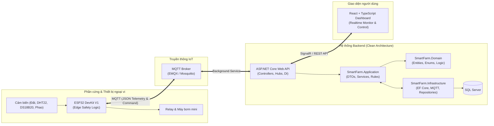

# Smart Farm Mini — Hệ Thống Giám Sát & Tưới Cây Tự Động Thông Minh (IoT)

[](https://dotnet.microsoft.com/)
[](https://react.dev/)
[](https://learn.microsoft.com/en-us/dotnet/architecture/modern-web-apps-azure/common-web-application-architectures)
[](LICENSE)

---

## 1. Giới thiệu dự án (Introduction)

**Smart Farm Mini** là giải pháp IoT ứng dụng thực tế nhằm giám sát các chỉ số sinh trưởng và tự động hóa quá trình tưới tiêu cho một chậu cây cảnh/cây trồng thông minh.

Dự án kết hợp giữa phần cứng nhúng biên (**ESP32** với cơ chế bảo vệ **Edge Safety**), truyền thông không đồng bộ (**MQTT**), nền tảng xử lý dữ liệu backend hiệu năng cao (**ASP.NET Core Web API**, **Entity Framework Core**, **SQL Server**), truyền thông thời gian thực (**SignalR**) và giao diện bảng điều khiển trực quan (**React + TypeScript**).

---

## 2. Mục tiêu hệ thống (System Objectives)

- **Giám sát liên tục:** Thu thập và phản ánh chính xác các thông số môi trường gồm độ ẩm đất, nhiệt độ & độ ẩm không khí, nhiệt độ nước và mực nước trong bình chứa.
- **Tự động hóa thông minh:** Thực hiện tưới nước tự động dựa trên quy tắc ngưỡng độ ẩm đất cài đặt trước (Soil Moisture Threshold & Target Moisture).
- **An toàn tại biên (Edge Safety First):** Đảm bảo an toàn phần cứng, ngăn ngừa cháy bơm và ngập úng ngay cả khi mất kết nối mạng Internet hoặc Backend gặp sự cố.
- **Phản hồi thời gian thực:** Cập nhật thông số cảm biến và trạng thái máy bơm lên Dashboard người dùng tức thời không cần reload trang qua SignalR.
- **Kiến trúc bền vững:** Áp dụng mô hình **Clean Architecture** và nguyên lý **SOLID**, tách biệt hoàn toàn giữa Domain Logic, Use Cases và Infrastructure.

---

## 3. Các tính năng chính (Planned Features)

### 3.1 Giám sát cảm biến thời gian thực (Telemetry)
- Đo độ ẩm đất (%): Cảm biến điện dung chống ăn mòn (Capacitive Soil Moisture Sensor).
- Đo nhiệt độ (°C) và độ ẩm không khí (%): Cảm biến kỹ thuật số DHT22.
- Đo nhiệt độ nước tưới (°C): Cảm biến DS18B20 chống nước.
- Phát hiện mực nước bình tưới: Công tắc phao (Float Switch) báo hiệu trạng thái đủ/hết nước.

### 3.2 Điều khiển máy bơm (Pump Control)
- **Chế độ thủ công (Manual Mode):** Bật/tắt máy bơm trực tiếp từ Dashboard hoặc qua lệnh API khẩn cấp.
- **Chế độ tự động (Automatic Mode):** Kích hoạt tưới khi độ ẩm đất $\le$ ngưỡng tối thiểu và tự ngắt khi độ ẩm đạt ngưỡng mục tiêu.
- **Cơ chế ngắt an toàn:**
  - Chặn hoặc ngắt bơm tức thì khi bình cạn nước.
  - Chặn bơm khi nhiệt độ nước vượt quá giới hạn an toàn ($> 40^\circ\text{C}$).
  - Tự động ngắt khi thời gian bơm liên tục vượt quá thời gian cho phép (Pump Run Timeout Watchdog).
  - Lệnh dừng khẩn cấp (Emergency Stop).

### 3.3 Cảnh báo & Lịch sử (Alerts & Auditing)
- Phát tín hiệu cảnh báo bất thường: cạn nước, thiết bị offline, cảm biến lỗi, nhiệt độ nước cao.
- Lưu trữ nhật ký các lần tưới: thời gian bắt đầu, kết thúc, thời lượng, độ ẩm trước và sau khi tưới, lượng nước ước tính tiêu thụ.
- Ghi vết hoạt động hệ thống qua System Logs.

---

## 4. Kiến trúc tổng thể (Overall Architecture & Data Flow)

Hệ thống được thiết kế theo mô hình luồng dữ liệu IoT khép kín:



### Clean Architecture Layers (Tổ chức trong `backend/`)
1. **`SmartFarm.Domain`**: Chứa Core Entities, Enums, Value Objects, Domain Exceptions và Business Rules. Hoàn toàn độc lập, không phụ thuộc vào bất kỳ thư viện hoặc công nghệ cơ sở dữ liệu nào.
2. **`SmartFarm.Application`**: Chứa Use Cases, DTOs, Interface Contracts (Repositories, Services), Mappings và Validation Logic.
3. **`SmartFarm.Infrastructure`**: Hiện thực hóa các interface của Application: `SmartFarmDbContext`, EF Core Migrations, Repository implementations, MQTT Client Service, SignalR Notifier.
4. **`SmartFarm.WebAPI`**: Điểm đón nhận HTTP requests (REST Controllers), Middleware xử lý lỗi tập trung, SignalR Hubs, Health Checks và Dependency Injection Composition Root.
5. **`SmartFarm.UnitTests`**: Dự án kiểm thử tự động sử dụng xUnit và Moq, bao phủ Domain Rules, Validation và Application Services.

---

## 5. Công nghệ sử dụng (Technology Stack)

| Hạng mục | Công nghệ | Phiên bản / Chi tiết |
|---|---|---|
| **Backend Framework** | C# / ASP.NET Core Web API | .NET 10 |
| **Database & ORM** | Microsoft SQL Server | Entity Framework Core 10 |
| **IoT Protocol** | MQTT | MQTTnet / EMQX Broker |
| **Realtime Push** | SignalR Core | WebSocket / Long Polling Fallback |
| **Frontend** | React, TypeScript, Tailwind CSS | Vite / Node.js 20+ |
| **Testing** | xUnit, Moq, Coverlet | Unit & Integration Testing |
| **API Documentation** | OpenAPI / Swagger UI | RESTful API Contract |
| **Hardware / Firmware** | ESP32 (C++ / Arduino IDE / PlatformIO) | FreeRTOS, PubSubClient, OneWire |

---

## 6. Cấu trúc Repository (Repository Structure)

Cấu trúc repository được phân tách module rõ ràng, tinh gọn và sạch sẽ:

```text
Smart-Farm-Mini/
├── backend/                              # Toàn bộ mã nguồn Backend (.NET 10)
│   ├── Smart_Farm_Mini.slnx              # Solution file chính
│   ├── SmartFarm.Domain/                 # Clean Architecture: Domain Layer
│   ├── SmartFarm.Application/            # Clean Architecture: Application Layer
│   ├── SmartFarm.Infrastructure/         # Clean Architecture: Infrastructure Layer
│   ├── SmartFarm.WebAPI/                 # Clean Architecture: Presentation Layer (API)
│   ├── SmartFarm.UnitTests/              # Dự án kiểm thử tự động (xUnit + Moq)
│   └── README.md
├── frontend/                             # Toàn bộ mã nguồn giao diện người dùng
│   ├── smartfarm-web/                    # Dự án Web Dashboard (React 19 + TypeScript)
│   └── README.md
├── firmware/                             # Toàn bộ mã nguồn nhúng ESP32
│   ├── esp32-controller/                # ESP32 điều khiển cảm biến và relay máy bơm
│   ├── esp32-camera/                    # ESP32-CAM chụp ảnh & giám sát hình ảnh
│   └── README.md
├── database/                             # Scripts SQL DDL, sơ đồ thiết kế ERD
│   └── README.md
├── docs/                                 # Tài liệu kiến trúc và sơ đồ hệ thống
│   ├── architecture/
│   ├── diagrams/
│   └── README.md
├── .env.example                          # Mẫu cấu hình biến môi trường
├── .gitignore                            # Bộ quy tắc loại bỏ file rác & bí mật
└── README.md                             # Tài liệu hướng dẫn chính
```

---

## 7. Yêu cầu môi trường (Prerequisites)

Trước khi tiến hành cài đặt và chạy hệ thống, đảm bảo máy tính đã cài đặt các công cụ sau:
- [.NET 10 SDK](https://dotnet.microsoft.com/download/dotnet/10.0) (Kiểm tra bằng lệnh `dotnet --version` $\ge$ 10.0.x).
- [Node.js](https://nodejs.org/) (Phiên bản 24.x; tối thiểu 22.12.0).
- [Microsoft SQL Server](https://www.microsoft.com/en-us/sql-server/sql-server-downloads) (2019/2022 Local, Express hoặc Docker container).
- [Git](https://git-scm.com/) (Hỗ trợ Git Bash trên Windows).
- Một MQTT Broker nội bộ (Ví dụ: [EMQX](https://www.emqx.io/) hoặc [Mosquitto](https://mosquitto.org/)).

---

## 8. Hướng dẫn Clone Repository

Sử dụng terminal (ưu tiên Git Bash trên Windows):

```bash
# 1. Clone repository từ GitHub
git clone https://github.com/LEHAu1/Smart-Farm-Mini.git

# 2. Di chuyển vào thư mục dự án
cd Smart-Farm-Mini

# 3. Kiểm tra các nhánh và chuyển sang nhánh phát triển
git checkout develop
```

---

## 9. Hướng dẫn cấu hình môi trường (Environment Setup)

1. Tạo file cấu hình môi trường từ mẫu:
   ```bash
   cp .env.example .env
   ```
2. Cấu hình chuỗi kết nối cơ sở dữ liệu trong `backend/SmartFarm.WebAPI/appsettings.Development.json` hoặc tạo file ghi đè cục bộ `backend/SmartFarm.WebAPI/appsettings.Local.json` (file này đã được bảo vệ bởi `.gitignore`):
   ```json
   {
     "ConnectionStrings": {
       "DefaultConnection": "Server=localhost;Database=SmartFarmMiniDb;Trusted_Connection=True;MultipleActiveResultSets=true;TrustServerCertificate=True"
     },
     "Jwt": {
       "Key": "Your_Development_Secret_Key_At_Least_32_Characters_Long!",
       "Issuer": "SmartFarm.API",
       "Audience": "SmartFarm.Client"
     }
   }
   ```
> [!WARNING]
> **Tuyệt đối không đưa chuỗi kết nối chứa mật khẩu thật hoặc khóa bí mật (Secret Key) vào các file được commit lên Git.**

---

## 10. Hướng dẫn chạy Backend (Web API)

### 10.1 Khôi phục gói thư viện và biên dịch
```bash
# Từ thư mục gốc repository: khôi phục dependencies và biên dịch
dotnet restore Smart_Farm_Mini.slnx
dotnet build Smart_Farm_Mini.slnx
```

### 10.2 Khởi chạy Web API
```bash
# Di chuyển vào thư mục Web API
cd backend/SmartFarm.WebAPI

# Chạy ứng dụng
dotnet run
```

Sau khi khởi chạy thành công, ứng dụng sẽ lắng nghe tại các cổng mặc định:
- **HTTP:** `http://localhost:5205`
- **HTTPS:** `https://localhost:7272`
- **Tài liệu Swagger UI:** `http://localhost:5205/swagger`
- **Kiểm tra trạng thái hệ thống (Health Check):** `http://localhost:5205/health`

---

## 11. Hướng dẫn chạy kiểm thử tự động (Testing)

Dự án bao gồm bộ kiểm thử đơn vị tự động giúp kiểm tra tính toàn vẹn của logic nghiệp vụ:

```bash
# Di chuyển vào thư mục backend
cd backend

# Chạy toàn bộ Unit Tests trong solution
dotnet test SmartFarm.UnitTests/SmartFarm.UnitTests.csproj --verbosity normal
```

---

## 12. Chiến lược phân nhánh Git (Git Branching Strategy)

Dự án áp dụng mô hình phân nhánh chuẩn **Git Flow**:

```text
main (Production / Stable Releases)
  ▲
  │ (Merge qua Pull Request có review)
develop (Integration Branch)
  ▲
  ├── feature/backend-setup (Phát triển nền tảng Backend Sprint 1)
  ├── feature/database-schema (Thiết kế ERD & Migrations)
  └── feature/irrigation-control (Logic điều khiển máy bơm & MQTT)
```

- **`main`**: Nhánh chính thức, chứa mã nguồn ổn định nhất đã qua kiểm thử và sẵn sàng triển khai.
- **`develop`**: Nhánh tích hợp mã nguồn của tất cả các tính năng đang phát triển trong Sprint.
- **`feature/<tên-tính-năng>`**: Nhánh tạo từ `develop` để thực hiện từng User Story / Issue cụ thể. Khi hoàn thành sẽ tạo Pull Request về `develop`.
- **`hotfix/<tên-lỗi>`**: Nhánh xử lý sự cố khẩn cấp xuất phát trực tiếp từ `main`.

---

## 13. Quy trình tạo Pull Request (Pull Request Workflow)

Để duy trì chất lượng mã nguồn cao và nhất quán trong toàn đội ngũ, mọi thành viên tuân thủ quy trình sau:

1. **Chuẩn bị trước khi tạo PR:**
   - Đảm bảo nhánh làm việc đã đồng bộ với nhánh cha (`git pull origin develop`).
   - Mã nguồn phải biên dịch thành công không có lỗi (`dotnet build Smart_Farm_Mini.slnx`).
   - Toàn bộ unit tests hiện có phải vượt qua 100% (`dotnet test`).
   - Không chứa commit rác, không commit secret hay file cấu hình cá nhân.

2. **Quy chuẩn thông điệp Commit (Conventional Commits):**
   - `feat: <nội dung>`: Bổ sung tính năng mới.
   - `fix: <nội dung>`: Sửa lỗi trong mã nguồn.
   - `refactor: <nội dung>`: Tái cấu trúc mã nguồn không đổi hành vi.
   - `test: <nội dung>`: Thêm mới hoặc cập nhật unit tests.
   - `docs: <nội dung>`: Cập nhật tài liệu kỹ thuật hoặc README.
   - `chore: <nội dung>`: Cập nhật cấu hình build, dependencies.

3. **Mẫu mô tả Pull Request (PR Description Template):**
   ```markdown
   ## 📌 Mục tiêu PR
   Mô tả ngắn gọn mục đích và User Story / Issue liên quan (ví dụ: Fixes #1, #2).

   ## 🛠️ Thay đổi chính
   - Tái cấu trúc thư mục repo tinh gọn (backend/, frontend/, firmware/, database/, docs/).
   - Cấu hình ASP.NET Core Web API, Swagger UI và Health Check (GET /health).
   - Chuẩn hóa Domain Layer (Entities, Enums, Constants, Exceptions).

   ## 🧪 Bằng chứng kiểm thử (Verification)
   - [x] Đã chạy `dotnet build Smart_Farm_Mini.slnx` thành công 100%.
   - [x] Endpoint `GET /health` trả về HTTP 200 {"status":"Healthy"}.
   - [x] Swagger UI hiển thị đầy đủ tài liệu API tại `/swagger`.
   ```

4. **Review & Merge:**
   - Yêu cầu tối thiểu 1 Technical Lead hoặc Senior Peer Review phê duyệt.
   - Sử dụng cơ chế **Squash and Merge** hoặc **Rebase and Merge** vào `develop` để giữ lịch sử Git tinh gọn.

---

## 14. Đội ngũ phát triển (Authors & Contributors)

Dự án được xây dựng và duy trì bởi nhóm kỹ sư **Smart Farm Mini Team**. Mọi đóng góp xin vui lòng gửi qua GitHub Pull Request.

## CI và quy trình đóng góp

Xem [CONTRIBUTING.md](CONTRIBUTING.md) để biết quy trình review, merge và cách bật bảo vệ nhánh. Workflow CI kiểm tra frontend/backend trên mỗi PR. Bằng chứng local: [issue #9](docs/testing/issue-9-ci.md).
