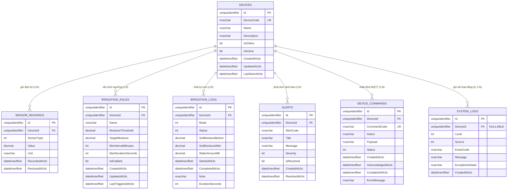

# Smart Farm Mini — Database Design & Schema

Thư mục lưu trữ toàn bộ tài liệu thiết kế cơ sở dữ liệu, sơ đồ ERD Draw.io, các tập lệnh SQL DDL và dữ liệu kiểm thử của hệ thống Smart Farm Mini.

---

## 1. Hệ quản trị CSDL & Công nghệ
- **RDBMS:** Microsoft SQL Server (2019 / 2022 / Express / LocalDB).
- **ORM:** Entity Framework Core 10 (Code-First & Fluent API).
- **Chuẩn hóa dữ liệu:** 3NF (Third Normal Form).
- **Khóa chính:** `UNIQUEIDENTIFIER` (GUID / UUIDv4) tự sinh độc lập tại tầng ứng dụng hoặc qua `NEWID()`.

---

## 2. Hướng dẫn mở và xem sơ đồ ERD bằng Draw.io trong VS Code

Dự án cung cấp file thiết kế sơ đồ chuẩn Draw.io tại:
👉 [`database/diagrams/SmartFarm_ERD.drawio`](diagrams/SmartFarm_ERD.drawio)

### Cách mở bằng extension `vscode-drawio`:
1. Cài đặt extension **Draw.io Integration** trên VS Code:
   - Tên extension: `hediet.vscode-drawio`
   - Hoặc tìm từ khóa `Draw.io Integration` trên VS Code Marketplace.
2. Click đúp chuột vào file [`database/diagrams/SmartFarm_ERD.drawio`](diagrams/SmartFarm_ERD.drawio) trong thanh Explorer của VS Code.
3. Giao diện trực quan của Draw.io sẽ mở ngay trong tab VS Code với đầy đủ màu sắc, thực thể, khóa chính, khóa ngoại và đường liên kết 1-N.

---

## 3. Sơ đồ quan hệ thực thể (Mermaid ERD)

---

## 4. Từ điển dữ liệu chi tiết (Data Dictionary)

### 4.1 Bảng `Devices` (Thiết bị IoT)
| Cột | Kiểu dữ liệu | Ràng buộc | Mô tả |
|---|---|---|---|
| `Id` | `UNIQUEIDENTIFIER` | PK | Mã định danh duy nhất (GUID) |
| `DeviceCode` | `NVARCHAR(50)` | UNIQUE, NOT NULL | Mã thiết bị nhận diện trong MQTT (VD: `ESP32-POT-001`) |
| `Name` | `NVARCHAR(100)` | NOT NULL | Tên thân thiện của thiết bị |
| `Description`| `NVARCHAR(500)` | NULL | Mô tả vị trí hoặc loại cây trồng |
| `IsOnline` | `BIT` | NOT NULL, DEFAULT 0 | Trạng thái kết nối mạng của ESP32 |
| `IsActive` | `BIT` | NOT NULL, DEFAULT 1 | Cờ kích hoạt hoạt động trong hệ thống |
| `CreatedAtUtc`| `DATETIMEOFFSET` | NOT NULL | Thời điểm khởi tạo thiết bị |
| `UpdatedAtUtc`| `DATETIMEOFFSET` | NOT NULL | Thời điểm cập nhật thông tin |
| `LastSeenAtUtc`| `DATETIMEOFFSET`| NULL | Thời điểm nhận gói tin cuối cùng |

### 4.2 Bảng `SensorReadings` (Dữ liệu chuỗi thời gian cảm biến)
| Cột | Kiểu dữ liệu | Ràng buộc | Mô tả |
|---|---|---|---|
| `Id` | `UNIQUEIDENTIFIER` | PK | Mã bản ghi |
| `DeviceId` | `UNIQUEIDENTIFIER` | FK (`Devices`), NOT NULL | Thiết bị ghi nhận dữ liệu (CASCADE DELETE) |
| `SensorType` | `INT` | NOT NULL | Enum: SoilMoisture(1), AirTemp(2), AirHum(3), WaterTemp(4), WaterLevel(5) |
| `Value` | `DECIMAL(10,2)` | NOT NULL | Giá trị đo được |
| `Unit` | `NVARCHAR(20)` | NOT NULL | Đơn vị đo (`%`, `°C`, `cm`...) |
| `RecordedAtUtc`| `DATETIMEOFFSET`| NOT NULL, INDEX | Thời điểm ESP32 ghi nhận |
| `ReceivedAtUtc`| `DATETIMEOFFSET`| NOT NULL | Thời điểm Backend tiếp nhận |

### 4.3 Bảng `IrrigationRules` (Quy tắc tưới tự động)
| Cột | Kiểu dữ liệu | Ràng buộc | Mô tả |
|---|---|---|---|
| `Id` | `UNIQUEIDENTIFIER` | PK | Mã quy tắc |
| `DeviceId` | `UNIQUEIDENTIFIER` | FK (`Devices`), NOT NULL | Thiết bị áp dụng quy tắc |
| `Name` | `NVARCHAR(100)` | NOT NULL | Tên quy tắc tưới |
| `MoistureThreshold` | `DECIMAL(5,2)` | NOT NULL | Độ ẩm đất bắt đầu kích hoạt tưới ($\%$) |
| `TargetMoisture` | `DECIMAL(5,2)` | NOT NULL, CHECK | Độ ẩm mục tiêu cần đạt sau tưới ($\%$) |
| `MinIntervalMinutes` | `INT` | NOT NULL, CHECK $\ge 0$ | Khoảng cách tối thiểu giữa 2 lần tưới (phút) |
| `MaxDurationSeconds` | `INT` | NOT NULL, CHECK $> 0$ | Thời gian tưới tối đa cho phép (giây) |
| `IsEnabled` | `BIT` | NOT NULL, DEFAULT 1 | Cờ bật / tắt quy tắc |

### 4.4 Bảng `IrrigationLogs` (Nhật ký phiên tưới)
| Cột | Kiểu dữ liệu | Ràng buộc | Mô tả |
|---|---|---|---|
| `Id` | `UNIQUEIDENTIFIER` | PK | Mã lần tưới |
| `DeviceId` | `UNIQUEIDENTIFIER` | FK (`Devices`), NOT NULL | Thiết bị thực hiện |
| `Mode` | `INT` | NOT NULL | Enum: Manual(1), Automatic(2) |
| `Status` | `INT` | NOT NULL | Enum: InProgress(1), Completed(2), Stopped(3), Failed(4) |
| `SoilMoistureBefore`| `DECIMAL(5,2)` | NULL | Độ ẩm đất trước khi bơm |
| `SoilMoistureAfter` | `DECIMAL(5,2)` | NULL | Độ ẩm đất sau khi ngắt bơm |
| `WaterAmountMl` | `DECIMAL(8,2)` | NULL, CHECK $\ge 0$ | Ước tính lượng nước tiêu thụ ($ml$) |
| `StartedAtUtc` | `DATETIMEOFFSET` | NOT NULL, INDEX | Thời điểm bắt đầu tưới |
| `CompletedAtUtc`| `DATETIMEOFFSET` | NULL | Thời điểm hoàn tất / dừng |
| `DurationSeconds`| `INT` | NULL | Tổng thời gian bơm chạy (giây) |

### 4.5 Bảng `Alerts` (Cảnh báo sự cố)
| Cột | Kiểu dữ liệu | Ràng buộc | Mô tả |
|---|---|---|---|
| `Id` | `UNIQUEIDENTIFIER` | PK | Mã cảnh báo |
| `DeviceId` | `UNIQUEIDENTIFIER` | FK (`Devices`), NOT NULL | Thiết bị xảy ra sự cố |
| `AlertCode` | `NVARCHAR(50)` | NOT NULL | Mã định danh cảnh báo (VD: `LOW_WATER_LEVEL`) |
| `Title` | `NVARCHAR(150)` | NOT NULL | Tiêu đề cảnh báo |
| `Message` | `NVARCHAR(1000)`| NOT NULL | Nội dung chi tiết sự cố |
| `Severity` | `INT` | NOT NULL | Enum: Info(1), Warning(2), Critical(3) |
| `IsResolved` | `BIT` | NOT NULL, DEFAULT 0 | Đã được người dùng xác nhận xử lý chưa |
| `CreatedAtUtc` | `DATETIMEOFFSET` | NOT NULL, INDEX | Thời điểm phát sinh cảnh báo |

### 4.6 Bảng `DeviceCommands` (Lệnh điều khiển)
| Cột | Kiểu dữ liệu | Ràng buộc | Mô tả |
|---|---|---|---|
| `Id` | `UNIQUEIDENTIFIER` | PK | Mã bản ghi |
| `DeviceId` | `UNIQUEIDENTIFIER` | FK (`Devices`), NOT NULL | Thiết bị nhận lệnh |
| `CommandCode` | `NVARCHAR(50)` | UNIQUE, NOT NULL | Mã lệnh duy nhất chống trùng lặp |
| `Action` | `NVARCHAR(50)` | NOT NULL | Hành động: `PUMP_ON`, `PUMP_OFF`, `EMERGENCY_STOP` |
| `Payload` | `NVARCHAR(MAX)` | NULL | Dữ liệu kèm theo lệnh (JSON) |
| `Status` | `INT` | NOT NULL, INDEX | Enum: Pending(1), Acknowledged(2), Completed(3), Failed(4) |

### 4.7 Bảng `SystemLogs` (Nhật ký hệ thống)
| Cột | Kiểu dữ liệu | Ràng buộc | Mô tả |
|---|---|---|---|
| `Id` | `UNIQUEIDENTIFIER` | PK | Mã log |
| `DeviceId` | `UNIQUEIDENTIFIER` | FK (`Devices`), NULL | Thiết bị liên quan (nếu có, `ON DELETE SET NULL`) |
| `Level` | `INT` | NOT NULL | Enum: Debug(1), Info(2), Warn(3), Error(4), Crit(5) |
| `Source` | `INT` | NOT NULL | Enum: Backend(1), Device(2), Sensor(3), Irrigation(4), System(5) |
| `EventCode` | `NVARCHAR(50)` | NOT NULL | Mã sự kiện |
| `Message` | `NVARCHAR(MAX)` | NOT NULL | Nội dung thông điệp |

---

## 5. Hướng dẫn chạy Script khởi tạo CSDL

Để khởi tạo CSDL trực tiếp trên SQL Server Management Studio (SSMS) hoặc Azure Data Studio:
1. Mở file script: [`database/scripts/01_InitSchema.sql`](scripts/01_InitSchema.sql).
2. Kết nối tới SQL Server của bạn (Ví dụ: `Server=DANG`).
3. Bấm **Execute (F5)** để thực thi tạo cơ sở dữ liệu `SmartFarmMiniDb`, tạo đầy đủ 7 bảng, khóa ngoại và chỉ mục tối ưu.
