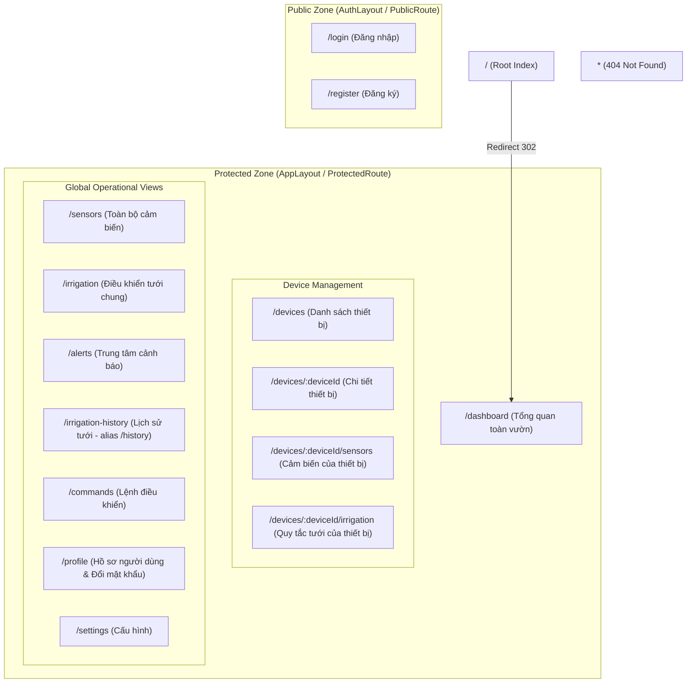

# Smart Farm Mini — Frontend Route Plan

> **Tài liệu quy hoạch Routing, Phân quyền truy cập và App Shell Hierarchy (Stage 0 & Stage 1)**  
> **Framework:** React Router v7 (`react-router-dom` 7.x)  
> **Dự án:** Smart Farm Mini Web UI

---

## 1. Sơ đồ Cây Phân Cấp Định Tuyến (Route Hierarchy)

---

## 2. Bảng Đặc Tả Chi Tiết Từng Tuyến Đường (Route Specification)

| Path | Layout | Route Guard | Breadcrumb Label | Chức năng & Quyền hạn |
|---|---|---|---|---|
| `/` | N/A | Public | N/A | Tự động chuyển hướng về `/dashboard`. |
| `/login` | `AuthLayout` | `PublicRoute` (chặn khi đã login) | Đăng nhập | Đăng nhập tài khoản, ghi nhớ `returnUrl`. |
| `/register` | `AuthLayout` | `PublicRoute` (chặn khi đã login) | Đăng ký | Đăng ký tài khoản người dùng mới. |
| `/dashboard` | `AppLayout` | `ProtectedRoute` | Tổng quan | Bảng điều hành trung tâm: chỉ số trung bình, trạng thái bơm, cảnh báo mới nhất. |
| `/devices` | `AppLayout` | `ProtectedRoute` | Quản lý thiết bị | Danh sách thiết bị IoT, tìm kiếm, lọc online/active, modal thêm thiết bị. |
| `/devices/:deviceId` | `AppLayout` | `ProtectedRoute` | Thiết bị / :deviceName | Chi tiết 1 node IoT, trạng thái kết nối, cấu hình phần cứng. |
| `/devices/:deviceId/sensors` | `AppLayout` | `ProtectedRoute` | Thiết bị / :deviceName / Cảm biến | Theo dõi chuyên sâu 5 chỉ số cảm biến, biểu đồ 24h & aggregates 7 ngày. |
| `/devices/:deviceId/irrigation` | `AppLayout` | `ProtectedRoute` | Thiết bị / :deviceName / Tưới nước | Cấu hình quy tắc tưới tự động (ngưỡng ẩm, thời gian bơm $\le 300s$), xem bơm chạy/dừng. |
| `/sensors` | `AppLayout` | `ProtectedRoute` | Cảm biến toàn hệ thống | Xem nhanh trạng thái cảm biến của tất cả thiết bị. |
| `/irrigation` | `AppLayout` | `ProtectedRoute` | Điều khiển tưới | Bảng điều khiển tưới tập trung của khu vườn. |
| `/alerts` | `AppLayout` | `ProtectedRoute` | Trung tâm cảnh báo | Giám sát sự cố: thiếu nước, nhiệt độ cao, thiết bị mất kết nối (Offline). |
| `/irrigation-history` | `AppLayout` | `ProtectedRoute` | Lịch sử tưới nước | Nhật ký các phiên tưới tiêu có phân trang, lọc Auto/Manual (`/history` hỗ trợ redirect về đây). |
| `/commands` | `AppLayout` | `ProtectedRoute` | Lệnh điều khiển | Xem lịch sử các lệnh MQTT (`PUMP_ON`, `PUMP_OFF`, `EMERGENCY_STOP`). |
| `/profile` | `AppLayout` | `ProtectedRoute` | Hồ sơ cá nhân | Xem thông tin tài khoản, đổi tên/SĐT, đổi mật khẩu. |
| `/settings` | `AppLayout` | `ProtectedRoute` | Cài đặt hệ thống | Cấu hình giao diện, thông báo và tùy chọn cá nhân. |
| `*` | Độc lập | Public | 404 | Trang báo lỗi không tìm thấy trang. |

---

## 3. Chiến Lược Điều Hướng & Bảo Vệ (Guards & Navigation Strategy)

### 3.1 Cơ chế `ProtectedRoute`
- Kiểm tra trạng thái xác thực người dùng thông qua Token (trong localStorage hoặc memory/context).
- Nếu chưa xác thực (`isAuthenticated = false`):
  - Chuyển hướng người dùng về `/login?returnUrl={currentPath}`.
  - Lưu lại `returnUrl` để chuyển hướng người dùng quay lại đúng trang họ mong muốn sau khi đăng nhập thành công.

### 3.2 Cơ chế `PublicRoute`
- Dành riêng cho trang `/login` và `/register`.
- Nếu người dùng đã đăng nhập thành công (`isAuthenticated = true`):
  - Tự động chuyển hướng vào `/dashboard` hoặc trang được chỉ định bởi `returnUrl`.

### 3.3 Dynamic Breadcrumbs Generation
- Breadcrumb trên Header của `AppLayout` được phân tích tự động dựa trên `useLocation().pathname`.
- Định dạng phân cấp:
  - Cấp 1: `Khu vườn của bạn`
  - Cấp 2: Tên danh mục (ví dụ: `Quản lý thiết bị`)
  - Cấp 3: Tên thực thể động (nếu có `:deviceId` -> tra cứu mã/tên thiết bị)
  - Cấp 4: Tab chức năng con (ví dụ: `Cảm biến` hoặc `Tưới nước`).

### 3.4 Đồng bộ Active State trên Sidebar Navigation
- Sử dụng `NavLink` của React Router v7.
- Kiểm tra active linh hoạt (`end={false}` cho các nhánh con của `/devices`).
- Highlight rõ ràng với nền `bg-primary/10`, viền trái `border-l-4 border-primary`, chữ `text-primary font-semibold`.

